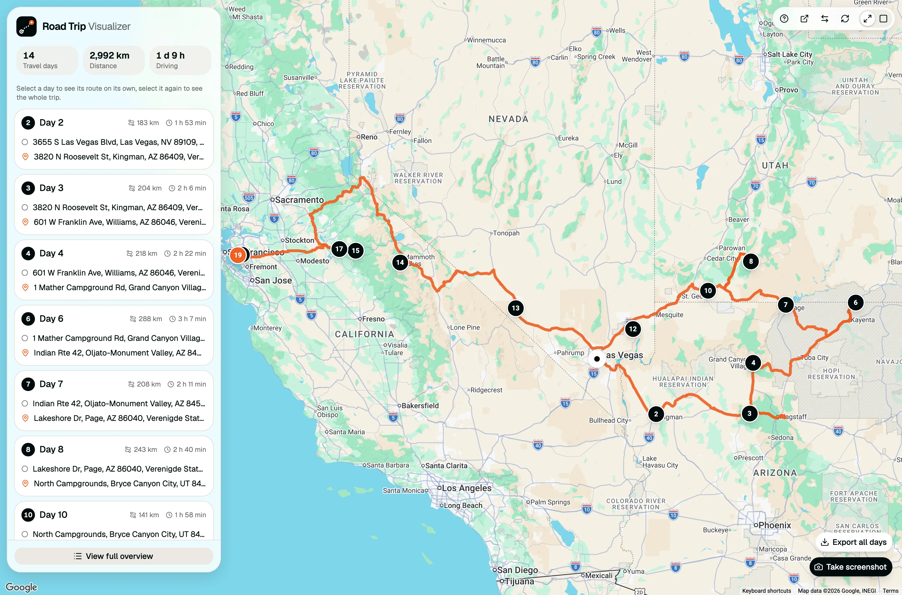
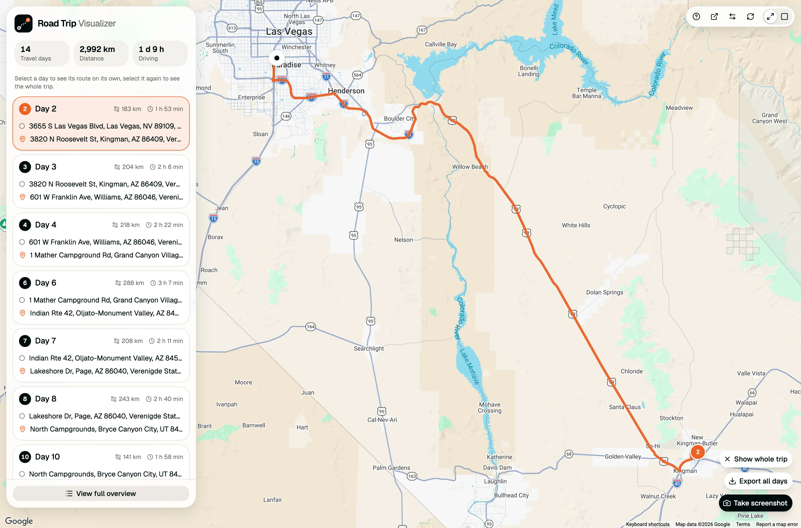

<div align="center">

# 🚐 Road Trip Visualiser

**Turn your road trip spreadsheet into an interactive map.**


**[🌍 Try the live demo](https://roadtrip.larsvanbraam.nl)**



</div>

## ✨ What it does

- 🗺️ **Plots your whole trip** on a map, straight from a Google Sheet
- 📅 **Day-by-day detail view** with the route, distance and travel time for each day
- ✈️ **Flying days** are drawn as a dashed arc between the airports, next to the driving route
- 🔄 **One source of truth**: keep planning in Sheets, the map follows
- 📦 **Export every travel day** as a zip of screenshots

<div align="center">

</div>

## 📖 The story

This project started with me planning a road trip to the west coast of America. The classic round
trip: from Los Angeles through the Grand Canyon and some national parks, ending in San Francisco
before flying back to Amsterdam. The trip changed about 500 times, as every option had its upsides
and downsides.

Google offers [MyMaps](https://www.google.com/maps/d/u/0/?hl=nl) for custom maps and layers, but it
felt clunky and meant maintaining two sources, as our planning lived in Google Sheets.

So I thought: "Why not do it myself? 🤔" And so this project was born. 💪

## 🌍 Live demo

Want to see it in action first? Open **[roadtrip.larsvanbraam.nl](https://roadtrip.larsvanbraam.nl)**.

> [!NOTE]
> The demo is rate limited to **30 requests per minute per user** to keep API costs in check. If you
> hit the limit, wait a minute and try again, or run your own copy with the steps below.

### 🧪 Sample trip

No sheet of your own yet? Paste this sheet ID into the demo to try it out. It's a three-week trip
through the American southwest and California, including the flights to and from Amsterdam:

```
1Td_qAVfp4PauwQKY3MSXqOID1bp7i-34D9ia2alWbUU
```

## 🧰 Built with

| Area    | Tools                                      |
| ------- | ------------------------------------------ |
| UI      | React 19, Tailwind CSS 4, Base UI, Zustand |
| Maps    | Google Maps JavaScript API                 |
| Data    | Google Sheets API                          |
| Tooling | Vite+, pnpm, Vitest                        |
| Hosting | Vercel                                     |

## 🚀 Quick start

```bash
cp .env.example .env   # add your Google API key
vp install
vp dev                 # http://localhost:3000
```

> [!NOTE]
> You need API keys for **Google Sheets** and **Google Maps**. Maps requires a credit card on your
> Google account. Read on for the full setup.

## 🔑 Getting started

This project relies on the following technologies so please make sure to you are able to get API
keys for all of them before investing time in setting this up.

- Google Sheets
- Google Maps (requires a credit card)

## 📊 Setting up the Sheet

The project uses Google Sheet as the source, you can find the template that I used here, make sure
to create a copy so you can start adding your own road trip and set the sharing policy to "Everyone
with the link"

**[➡️ Google sheet template](https://docs.google.com/spreadsheets/d/1vx0FWu5zmdzHatcLx4ZkxGPp4sdbuDkPIDovCp1lei8/edit?usp=sharing)**

### Base trip configuration

First off you'll have update the `Overview` tab with your departure and return flights, this will
generate the stops tab that you can fill in next.

### Fill in your trip information

This is the part that will most likely change many times during the planning of your trip. Make sure
to fill in all the stops you would like to make during your trip. It will automatically generate the
distance and travel time for your addresses, so you get a first overview of the distance you'll be
travelling.

## ☁️ Getting the Google keys

First of all you'll need a Google developer account and go to the console where you'll be creating a
new project for your road trips

**[☁️ Google cloud console](https://console.cloud.google.com/)**

### Enable Google Maps

This steps requires you to attach your creditcard to your account, note that the first x amount of
requests is still free but be aware you do not exceed this limit to avoid unexpected costs.

### Enable Google Sheets

Simply enable Google Sheets Api for your API key.

### Creating a .env file

The next step is to create a .env file with the newly fetched credentials.

```
VITE_GOOGLE_API_KEY=[ADD_GOOGLE_API_KEY_HERE]
VITE_TAB_NAME=Stops
```

## 🛠️ Development

This project uses [Vite+](https://viteplus.dev) and pnpm. Copy `.env.example` to `.env` and fill in
your Google API key first.

| Command      | What it does                                     |
| ------------ | ------------------------------------------------ |
| `vp install` | Install dependencies                             |
| `vp dev`     | Start the dev server on http://localhost:3000    |
| `vp check`   | Format, lint and type-check (runs on pre-commit) |
| `vp test`    | Run the Vitest test suite                        |
| `vp build`   | Production build to `dist/`                      |
| `vp preview` | Preview the production build                     |

> [!TIP]
> Restrict your Google API key to your site's HTTP referrers and to the Maps JavaScript and
> Sheets APIs. The key ends up in the client bundle, so that restriction is its only protection.
